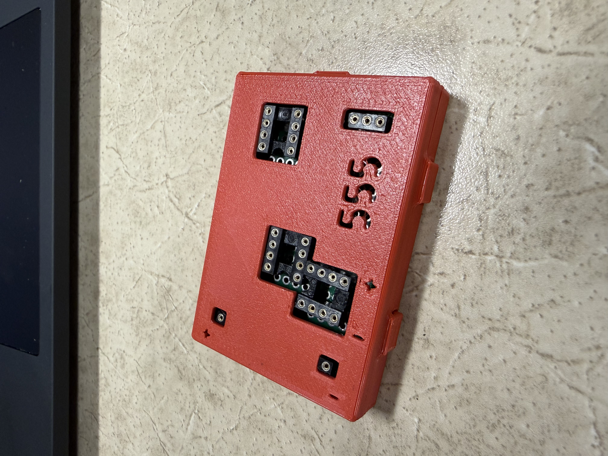
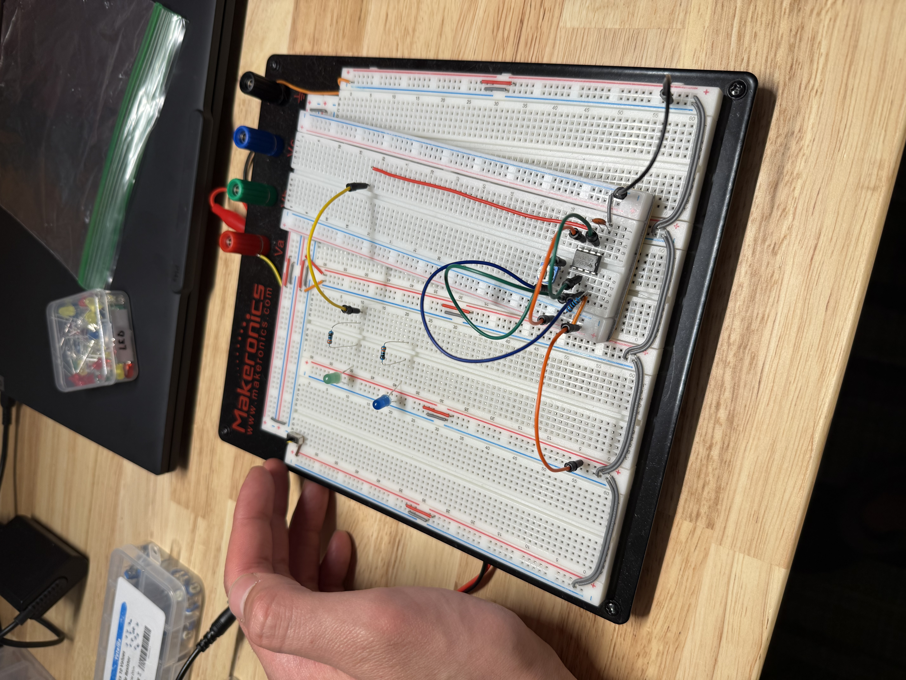
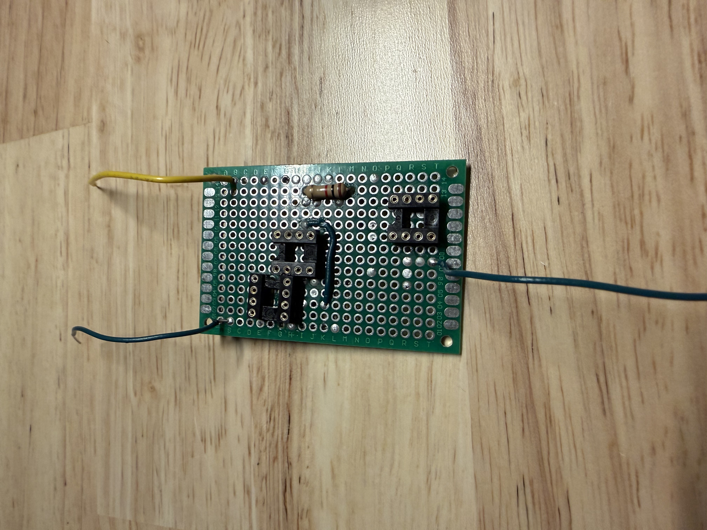
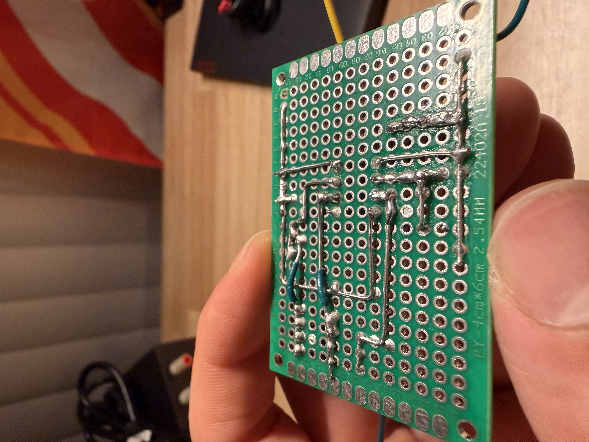
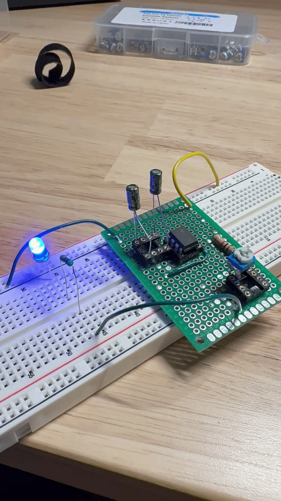
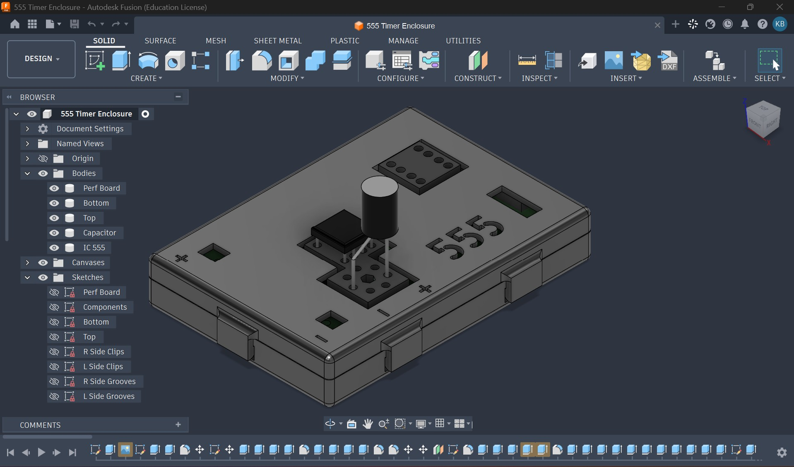
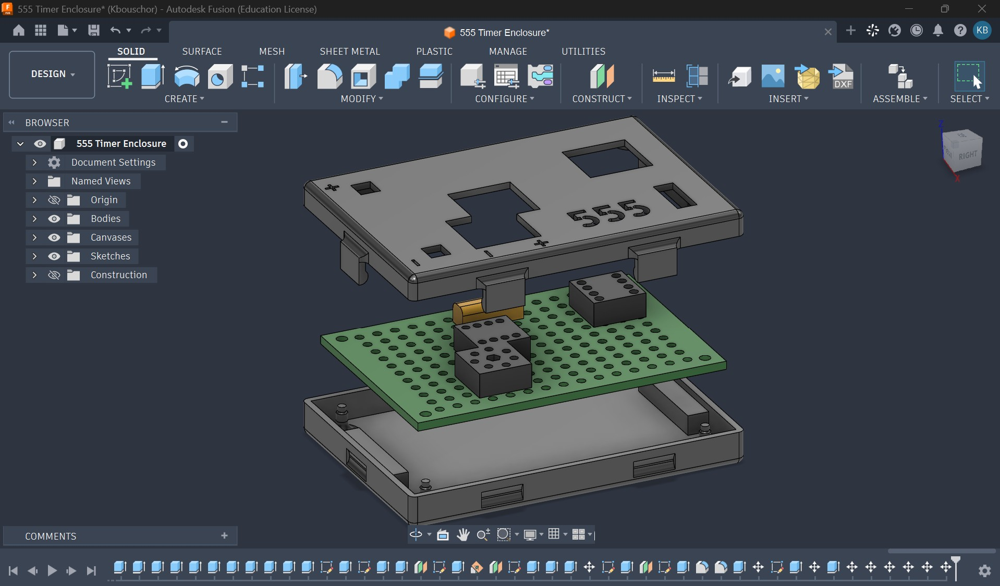
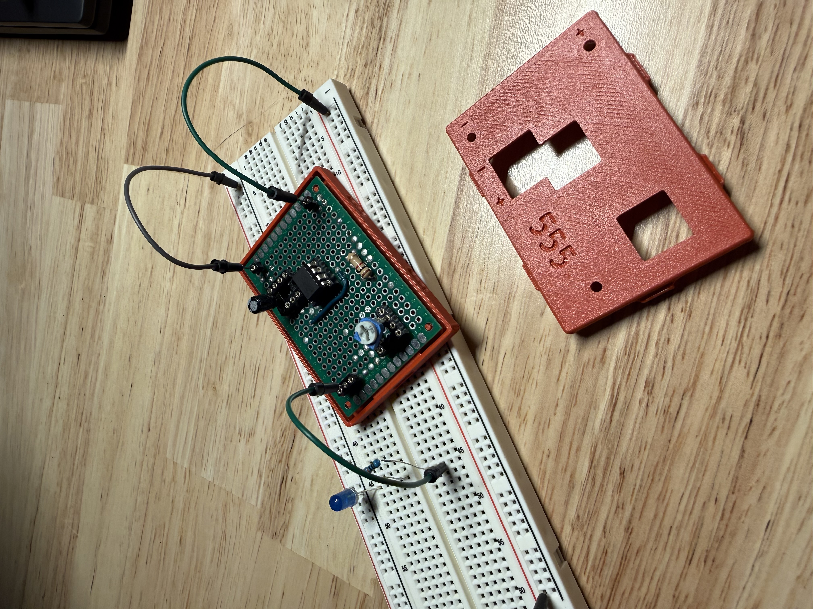

# Portable Adjustable 555 Timer Signal Generator

> A compact, handheld square-wave signal generator built with a 555 timer circuit, custom soldered perfboard, and a 3D-printed enclosure designed in CAD.

## Overview
* **Status:** Completed
* **Core Technology:** 555 Timer IC, Perfboard Soldering, Autodesk CAD, 3D Printing, Enclosure Design
* **Primary Objective:** Build a robust, self-contained portable tool for generating adjustable frequency/pulse signals in the field.

---

## Build Process & Design
* **Prototyping:** Validated circuit logic using a modular breadboard layout.
* **Circuit Construction:** Transferred the design to a dedicated perfboard with clean underside soldering and component saddle arrangement.
* **Enclosure Engineering:** Modeled a custom 2-part enclosure with an exploded-view layout in CAD, integrating the perfboard directly into the 3D-printed housing.

---

## Build Gallery
| Breadboard Concept | Perfboard Build | Underside Soldering |
| :---: | :---: | :---: |
|  |  |  |

| Functional Testing | CAD Enclosure Body | CAD Exploded View |
| :---: | :---: | :---: |
|  |  |  |

| Mechanical Assembly | Hero Shot |
| :---: | :---: |
|  |  |

---

## Future Improvements / Next Steps
- [ ] Add LED light to enclosure for blink speed.
- [ ] Add additional output terminals for components.
